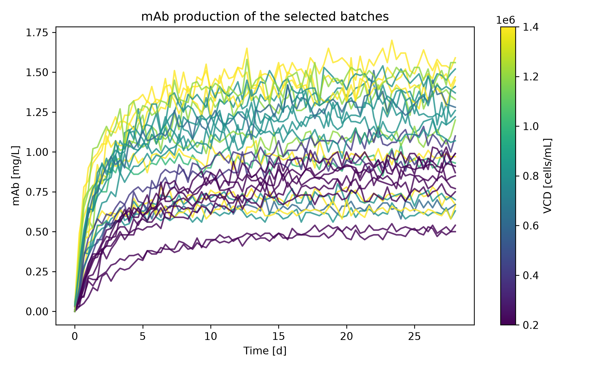
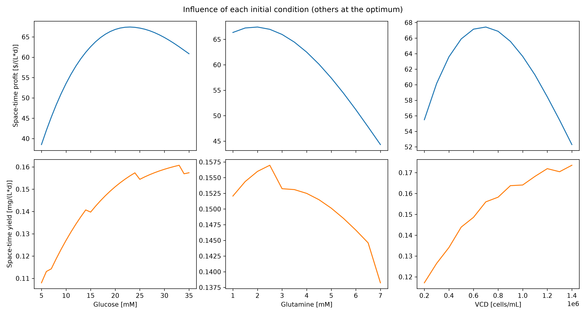
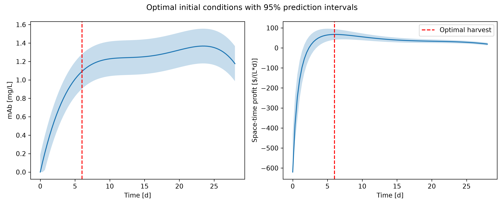

# Optimal Harvest Strategies for Monoclonal Antibody 

How can we make the most profit from monoclonal antibody production? 
This project answers this question using Python and machine learning. 
We analyzed 30 batch runs to understand how initial nutrients and cell density affect antibody yields. 
The program predicts the best harvest time and starting conditions to maximize space-time profit. 
Crucially, it provides 95% prediction intervals to quantify uncertainty, helping engineers make reliable and safe economic decisions.

## Highlights
- Designed a maximin space-filling algorithm to strategically select 30 informative batch runs from 1000 available datasets.
- Developed a Polynomial Regression model (degree 3) and a custom Python class to compute 95% prediction intervals.
- Evaluated model performance against a Random Forest regressor using strict GroupKFold cross-validation to prevent data leakage.
- Established a complete economic balance integrating nutrient costs, mAb value, and bioreactor downtime.
- Optimized initial operating conditions and harvest time to maximize space-time profit while quantifying prediction uncertainty.

## Environment
- Python 3.14.7
- matplotlib 3.11.0
- numpy 2.5.2
- pandas 3.0.5
- scikit-learn 1.9.0
- scipy 1.18.0

## Code Design

Running `main.py` executes a linear pipeline of six stages. Each stage produces the input of the next one, and the results are exported to the `tables/` and `figures/` directories.

### 1. Experimental Design

The program reads the table of initial conditions and decides which 30 batch runs to use. Duplicate combinations of glucose, glutamine and cell density are removed, only batches whose files are available locally are kept, and the three factors are scaled to the range 0 to 1. 
The program then applies a deterministic maximin strategy: it selects the 8 corners of the design space, adds the point closest to the centre, and repeatedly adds the candidate that is farthest from all points already chosen.

This stage is necessary because the number of runs is the scarcest resource of the project. A random selection could cluster the experiments and leave large gaps, whereas a space-filling design spreads the information evenly. 
The stage also defines the region in which the final model can be trusted, since the optimizer later searches only inside the range covered here. Because the algorithm is deterministic, the same 30 batches are selected every time the program runs.

### 2. Data Loading and Assembly

Each selected batch file is read into a small `Batch` object that stores its initial conditions together with its measured time series. 
A one-line summary of every batch is printed as a quick check that the right files were loaded. The batches are then stacked into one long table with one row per measurement, containing the three initial conditions (repeated at every time point), the time and the mAb concentration.

This flat representation is what the regression model requires. Treating time as an input feature, rather than fitting one curve per batch, allows a single model to describe how the entire mAb trajectory depends on the starting conditions. 
The resulting table is the common input of every later stage.

### 3. Model Comparison

Five regression models are compared: polynomials of degree 2, 3, 4 and 5, and a random forest. Each is evaluated with five-fold cross-validation in which the folds are grouped by batch (`GroupKFold`). 
Grouping is essential because measurements from the same batch are strongly correlated; a random split would place neighbouring time points of one batch in both the training and the test set and would greatly overstate accuracy. 
The RMSE and R² of each model are computed on the held-out batches, exported to a table, and the best polynomial is selected automatically and displayed in a parity plot.

This stage exists because the right model complexity cannot be known in advance, and the optimizer is only as reliable as the model that drives it. 
Selecting the degree on unseen batches protects against overfitting, which is a real risk with only 30 distinct experimental conditions.

### 4. Final Model and Uncertainty Quantification

The selected degree is refitted on all 30 batches with the custom `PolynomialRegressor` class. The inputs are standardized, expanded into polynomial terms and multiplied by time, so the predicted mAb concentration is exactly zero at the start of every batch, as in the real process. 
The coefficients are obtained by least squares, and the class stores the residual variance, the degrees of freedom and the inverse of the normal-equation matrix. A 95% prediction interval is then obtained from the leverage of each point and Student's t-distribution.

Cross-validation only chooses the architecture; the best estimate of the coefficients uses every available batch. 
The stored statistics let the program return not only a point estimate but also an interval for any new condition, without resampling. 
This is what makes an economic risk assessment possible.

### 5. Economic Optimization

The program builds a grid of candidate conditions inside the explored range (glucose in 1 mM steps, glutamine in 0.5 mM steps, cell density in steps of 100,000 cells/mL, and every sampled harvest time from 0 to 28 days). 
The model predicts the mAb concentration at every grid point, with negative predictions clipped to zero. Each point is then converted into economics: cost of the medium and cells, value of the antibody, and space-time profit:

`Space-time profit = (1000 × mAb − Cost) / (Harvest time + 1 day of downtime)`

A grid search is appropriate because the problem has only four variables and the model is cheap to evaluate, so the global optimum can be found without any risk of local optima. 
Restricting the grid to the explored range prevents the optimizer from exploiting polynomial extrapolation. This stage turns the predictive model into a decision.

### 6. Sensitivity Analysis and Reporting

Finally, the program reports the optimum with 95% prediction intervals, propagating the interval on mAb through the economic formulas. 
It also produces a time profile of mAb and profit at the optimal conditions, and a one-factor-at-a-time sensitivity analysis in which each initial condition is varied while the others stay at their optimal values and the harvest time is re-optimized each time. All results are exported as CSV tables and high-resolution figures.

A single optimal number is not enough to support a decision. The intervals show how much confidence to place in it, the profile shows how sharply the harvest time must be chosen, and the sensitivity analysis explains why the optimum lies where it does.

## Analysis

### Justification of Initial Conditions

The data set offers 7 levels of glucose (5 to 35 mM), 7 levels of glutamine (1 to 7 mM) and 7 levels of initial viable cell density (0.2 to 1.4 million cells/mL), each in three replicates. 

I used a maximin space-filling design for three reasons. First, including all eight corners means the model interpolates everywhere inside the box and never has to extrapolate, which matters because the optimizer evaluates the model up to the edges. 
Second, the centre point (20 mM glucose, 4 mM glutamine, 800,000 cells/mL) lets the model detect curvature, which a corner-only design cannot do. 
Third, repeatedly adding the point farthest from the existing ones spreads the remaining 21 runs evenly and avoids redundant, nearly identical experiments. This is clearly preferable to a random selection, which could leave large gaps in the design space.

I chose 30 different combinations rather than fewer combinations with replicates. Replicates would have measured the experimental noise directly, but each batch already contains many time points, and the residual variance of the regression gives a usable estimate of noise. 

*Table 1: List of the 30 batch runs selected for training the model.*

|Batch ID|Glucose [mM]|Glutamine [mM]|VCD [cells/mL]|
|--------|------------|--------------|--------------|
|1       |5.0         |1.0           |200000.0      |
|19      |5.0         |1.0           |1400000.0     |
|31      |5.0         |2.0           |800000.0      |
|70      |5.0         |4.0           |600000.0      |
|115     |5.0         |6.0           |800000.0      |
|127     |5.0         |7.0           |200000.0      |
|145     |5.0         |7.0           |1400000.0     |
|211     |10.0        |4.0           |200000.0      |
|223     |10.0        |4.0           |1000000.0     |
|229     |10.0        |4.0           |1400000.0     |
|304     |15.0        |1.0           |800000.0      |
|403     |15.0        |6.0           |400000.0      |
|415     |15.0        |6.0           |1200000.0     |
|445     |20.0        |1.0           |400000.0      |
|457     |20.0        |1.0           |1200000.0     |
|514     |20.0        |4.0           |800000.0      |
|577     |20.0        |7.0           |800000.0      |
|619     |25.0        |2.0           |800000.0      |
|652     |25.0        |4.0           |200000.0      |
|670     |25.0        |4.0           |1400000.0     |
|862     |30.0        |7.0           |200000.0      |
|880     |30.0        |7.0           |1400000.0     |
|883     |35.0        |1.0           |200000.0      |
|901     |35.0        |1.0           |1400000.0     |
|913     |35.0        |2.0           |800000.0      |
|925     |35.0        |3.0           |200000.0      |
|952     |35.0        |4.0           |600000.0      |
|967     |35.0        |5.0           |200000.0      |
|982     |35.0        |5.0           |1200000.0     |
|997     |35.0        |6.0           |800000.0      |

*Figure 1: mAb production over time for the 30 selected batches, colored by initial VCD.*

### Model Architecture Justification
Two main architectures were compared: Polynomial Regression and Random Forest.
- **Polynomial Regression (Degree 3):** Achieved the best cross-validated performance (RMSE = 0.108 mg/L, R² = 0.903). It successfully captures the non-linear relationship between time and mAb accumulation, as well as the interactions between glucose and glutamine.
- **Random Forest:** Achieved an RMSE of 0.137 mg/L. While robust, it tended to overfit the noisy biological data and struggled to extrapolate the smooth time-dependent mAb curve.
- **Why Degree 3?** Degrees 4 and 5 suffered from severe overfitting, as evidenced by negative R² values (-3.10 and -0.79 respectively) during cross-validation. Degree 2 underfit the data (RMSE = 0.160).

*Table 2: Cross-validation results for model selection. Lower RMSE and higher R² indicate better performance.*

|Model                |CV RMSE [mg/L]     |CV R2              |
|---------------------|-------------------|-------------------|
|Polynomial (degree 2)|0.1607293338083308 |0.7849353823138349 |
|Polynomial (degree 3)|0.10792406655435548|0.9030349380493609 |
|Polynomial (degree 4)|0.7020298836846779 |-3.1028900217067656|
|Polynomial (degree 5)|0.46446592502634987|-0.7959175444026192|
|Random forest        |0.13755051145490574|0.8424918261866311 |

**Advantages of the selected model:** It provides a smooth, interpretable curve, it allows for the direct calculation of prediction intervals via the leverage matrix, and it is computationally very fast.

**Limitations:** The model is strictly limited to the bounds of the explored data. 
It cannot predict what would happen at glucose concentrations > 35 mM or harvest times > 28 days. 
Furthermore, it assumes that pH and dissolved oxygen were perfectly controlled, as they were not varied in the dataset.

### Influence of Initial Conditions
The sensitivity analysis reveals how each factor influences the space-time profit:

*Figure 2: Sensitivity analysis of space-time profit and yield to each initial condition (others held at the optimum).*

- **Initial glucose.** Space-time profit increases from about 38 \$/(L·d) at 5 mM to a maximum of about 67 \$/(L·d) near 23 mM, then declines slightly to about 61 \$/(L·d) at 35 mM. More glucose supports more antibody, but every mM costs 10 \$/L, so beyond about 23 mM the extra antibody no longer pays for the extra medium. The space-time yield, which ignores cost, keeps increasing up to roughly 33 mM. Profit and yield therefore have different optima.
- **Initial glutamine.** Profit is highest at low concentrations (about 67 \$/(L·d) at 1.5 to 2 mM) and falls steadily to about 44 \$/(L·d) at 7 mM. Glutamine is the most expensive nutrient (20 \$/L per mM), while the gain in mAb at higher concentrations is small, so the optimum lies at the lower end of the range. Yield also peaks at a low concentration (about 2.5 mM) and decreases beyond it, so high glutamine is unfavourable for both criteria.
- **Initial viable cell density.** Profit peaks at about 700,000 cells/mL (about 67 \$/(L·d)) and is lower both at 200,000 cells/mL (about 55 \$/(L·d)) and at 1.4 million cells/mL (about 52 \$/(L·d)). Cells are the largest cost item at the optimum (350 \$/L of the 620 \$/L), so a higher density raises the cost faster than the value. In contrast, the space-time yield rises almost steadily with cell density, from about 0.12 to 0.17 mg/(L·d). Maximizing yield alone would therefore push the process towards expensive, heavily seeded cultures, which is why space-time profit is the appropriate objective.
- **Harvest time.** At the optimal conditions the profit rises steeply during the first days and peaks around day 6. After that, the mAb concentration grows only slowly while the cycle keeps getting longer, so each additional day adds more to the denominator of the space-time profit than to the numerator (Figure 5).

The profit curves are fairly flat around the optimum (for glucose, anywhere between about 18 and 29 mM is within 2 \$/(L·d) of the maximum), so the process is robust to small deviations from the recommended values.

### Recommended Conditions and Economic Estimates
Based on the optimization, the recommended operating conditions to maximize space-time profit are:

*Table 3: Optimal operating conditions and economic estimates with 95% prediction intervals (PI).*

|Quantity                   |Estimate          |Lower 95% PI      |Upper 95% PI      |
|---------------------------|------------------|------------------|------------------|
|Initial glucose [mM]       |23.0              |                  |                  |
|Initial glutamine [mM]     |2.0               |                  |                  |
|Initial VCD [cells/mL]     |700000.0          |                  |                  |
|Harvest time [d]           |6.0               |                  |                  |
|Cell culture cost [$/L]    |620.0             |                  |                  |
|mAb at harvest [mg/L]      |1.09197790788458  |0.9039840510975534|1.2799717646716064|
|Cell culture value [$/L]   |1091.97790788458  |903.9840510975534 |1279.9717646716065|
|Space-time profit [$/(L*d)]|67.42541541208286 |40.56915015679335 |94.28168066737236 |
|Space-time yield [mg/(L*d)]|0.1559968439835114|0.1291405787282219|0.1828531092388009|

The cost is a deterministic function of the chosen conditions (23 mM × 10 \$/L + 2 mM × 20 \$/L + 700,000 cells/mL × 0.0005 \$/L = 620 \$/L), so it has no interval. 

The expected profit per batch is 1,092 − 620 = 472 \$/L, spread over a cycle of 6 d of culture plus 1 d of downtime, which gives 67.4 \$/(L·d). 

The lower end of the interval for the space-time profit (40.6 \$/(L·d)) is still positive, so the process is expected to be profitable even under pessimistic assumptions.

*Figure 3: Profiles of mAb titer and space-time profit at the optimal conditions, with 95% prediction intervals.*

Space-time profit rises steeply during the first days, because mAb accumulates much faster than the cycle lengthens, and turns negative before about 2.3 d because the value has not yet covered the 620 \$/L cost. 

It peaks around day 6 and then declines slowly, since after day 6 the mAb concentration grows only slowly while the cycle keeps getting longer, so each additional day of culture adds more to the denominator than to the numerator. 

The curve is flat between roughly day 5 and day 7 (values between about 65 and 67 \$/(L·d)), so harvesting a day early or late costs very little

### Applications
This model can be used by process development engineers to rapidly screen initial conditions before running expensive physical experiments.
By inputting the cost of their specific cell culture media, they can instantly find the optimal harvest time. 
In a digital twin scenario, this model could be integrated with real-time sensor data (Raman spectroscopy for glucose/glutamine) to dynamically adjust the harvest time based on the actual growth rate of the batch.can be used by process development engineers to rapidly screen initial conditions and harvest times before running expensive physical experiments. It can also be integrated into a digital twin of a bioreactor for real-time decision support.